<a href="https://annrosept.github.io/AnnRosePT/index.html"></a>

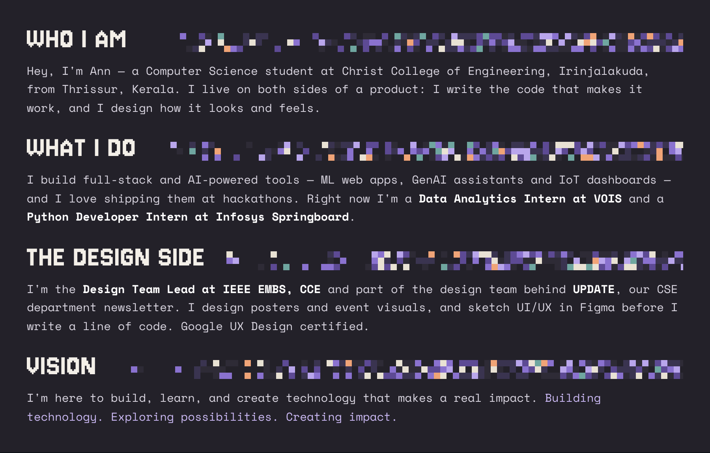

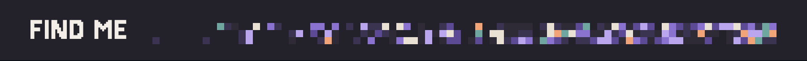

<table>
  <tr><th align="center">LinkedIn</th><th align="center">GitHub</th><th align="center">Gmail</th><th align="center">Portfolio</th><th align="center">3D Card</th></tr>
  <tr><td align="center"></td><td align="center"></td><td align="center"></td><td align="center"></td><td align="center"></td></tr>
</table>

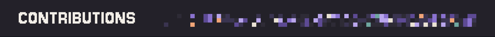

<a href="https://github.com/AnnRosePT">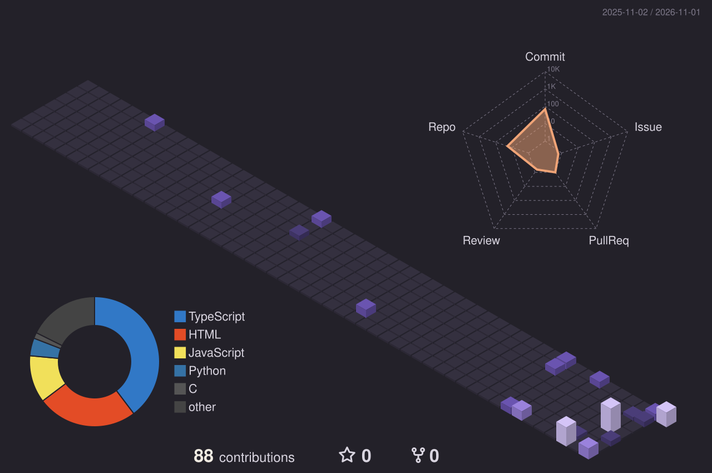</a>

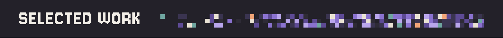

  <a href="https://github.com/AnnRosePT/placed">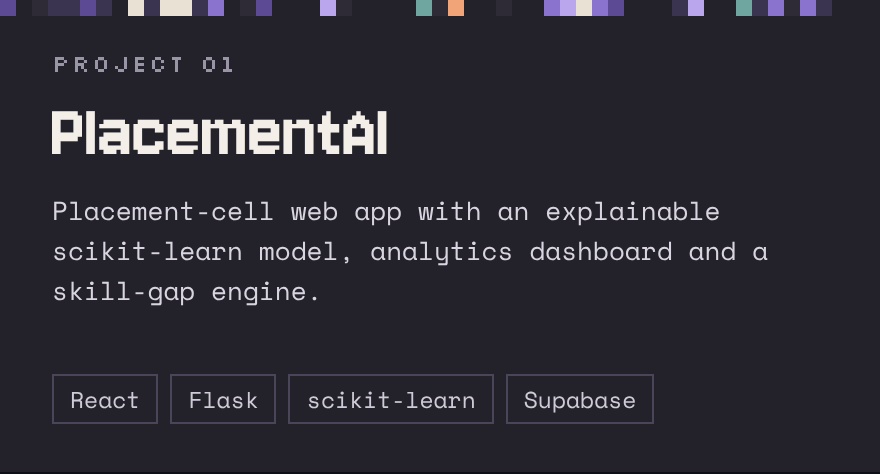</a>
  <a href="https://anavandi-connect.vercel.app">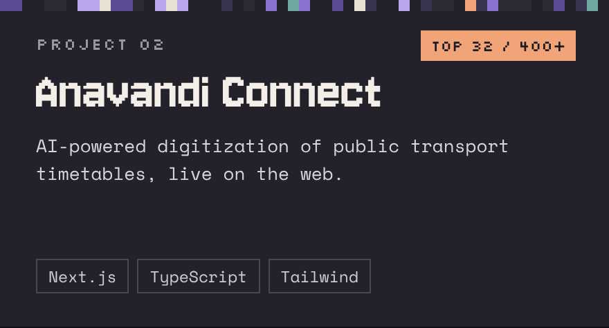</a>

  <a href="https://github.com/AnnRosePT/Aquasense">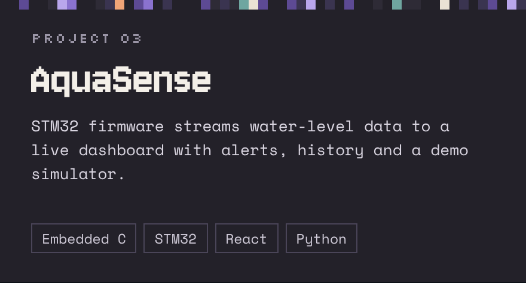</a>
  <a href="https://dbt-guard.vercel.app">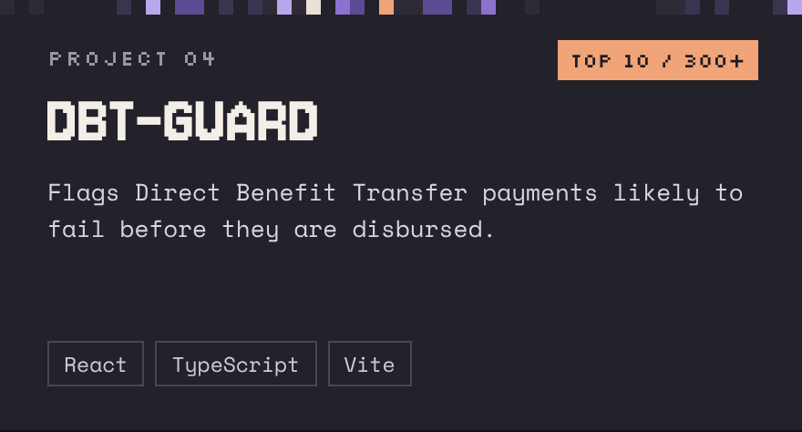</a>

<a href="https://github.com/AnnRosePT/placed">PlacementAI</a> ·
<a href="https://github.com/AnnRosePT/anavandi-connect">Anavandi Connect</a> (<a href="https://anavandi-connect.vercel.app">live</a>) ·
<a href="https://github.com/AnnRosePT/Aquasense">AquaSense</a> ·
<a href="https://github.com/AnnRosePT/DBT-GUARD">DBT-GUARD</a> (<a href="https://dbt-guard.vercel.app">live</a>) ·
also <a href="https://github.com/AnnRosePT/FitnessBuddy-AgenticAI">Fitness Buddy</a> and <a href="https://github.com/AnnRosePT/IMPACT">LuminousCore</a>

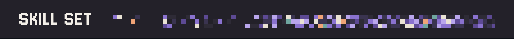

<table>
  <tr><td align="center" width="96"> Figma</td><td align="center" width="96"> Python</td><td align="center" width="96"> Java</td><td align="center" width="96"> C</td><td align="center" width="96"> JavaScript</td><td align="center" width="96"> TypeScript</td><td align="center" width="96"> HTML</td></tr>
  <tr><td align="center" width="96"> CSS</td><td align="center" width="96"> React</td><td align="center" width="96"> Next.js</td><td align="center" width="96"> Tailwind</td><td align="center" width="96"> Node.js</td><td align="center" width="96"> Spring</td><td align="center" width="96"> Django</td></tr>
  <tr><td align="center" width="96"> Flask</td><td align="center" width="96"> FastAPI</td><td align="center" width="96"> Sklearn</td><td align="center" width="96"> OpenCV</td><td align="center" width="96"> Postgres</td><td align="center" width="96"> Supabase</td><td align="center" width="96"> Git</td></tr>
  <tr><td align="center" width="96"> GitHub</td><td align="center" width="96"> Linux</td><td align="center" width="96"> AWS</td><td align="center" width="96"> Azure</td><td align="center" width="96"> Vercel</td></tr>
</table>

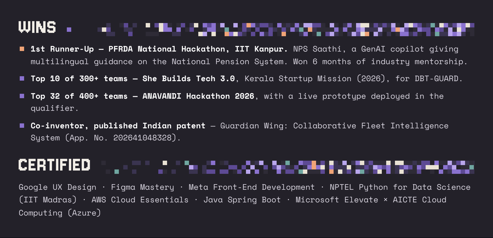
