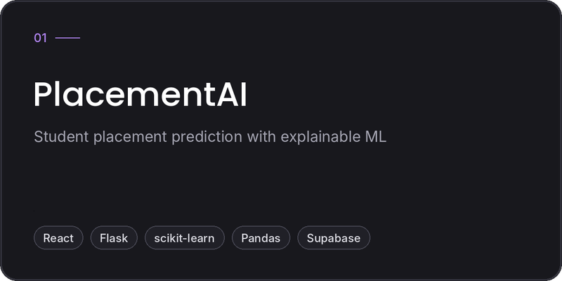
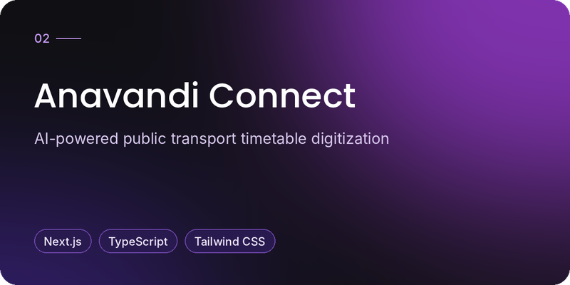
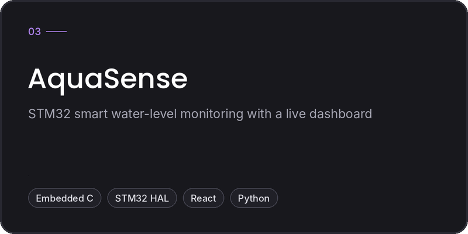
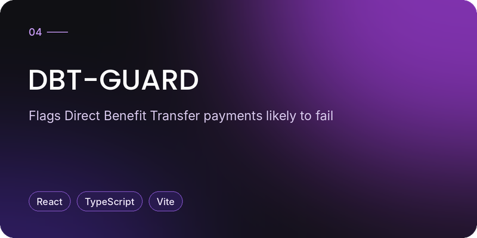

  &nbsp;
  &nbsp;
  &nbsp;
  

  <b>1st Runner-Up, PFRDA National Hackathon at IIT Kanpur</b> for <i>NPS Saathi</i>, an AI-native multilingual pension copilot

 

## About Me

I'm a B.Tech Computer Science student at Christ College of Engineering, Irinjalakuda (2024–2028, CGPA 8.5). I like working on both sides of a product: writing the code that makes it work and designing how it looks and feels.

- Building full-stack and AI-powered apps with Python, React, Django and Spring Boot.
- Designing UI/UX in Figma, plus posters, newsletters and event visuals for campus teams.
- Currently a Data Analytics Intern at VOIS and a Python Developer Intern at Infosys Springboard.
- Happiest when a project solves a real problem for real people.

 

## UI/UX & Poster Design

Design is a big part of how I work, not an afterthought.

- **Design Team Lead**, IEEE EMBS, Christ College of Engineering: posters and visuals for the chapter's events.
- **Design team**, UPDATE, the CSE department newsletter: layout and visual design.
- **UI/UX:** wireframes, prototypes and app screens in Figma, including the interfaces for my own projects below.
- **Training:** Google UX Design certificate · BCG X UI/UX job simulation · Figma Mastery

 

## Technical Skills

**Languages** 

**Frontend** 

**Backend** 

**AI / ML & Data** 

 NumPy · Pandas · MediaPipe · Generative AI · LangFlow · IBM watsonx

**Tools & Cloud** 

 

## Featured Projects

  
  

  
  

| Project | What it does | Links |
| :-- | :-- | :-- |
| **PlacementAI** | Placement-cell web app with a scikit-learn model that explains each prediction, an analytics dashboard, a skill-gap engine and role-based admin. *React · Flask · scikit-learn · Pandas · Supabase* | [Repo](https://github.com/AnnRosePT/placed) |
| **Anavandi Connect** | AI-powered public transport timetable digitization platform. Top 32 of 400+ teams, ANAVANDI Hackathon 2026. *Next.js · TypeScript · Tailwind CSS* | [Repo](https://github.com/AnnRosePT/anavandi-connect) · [Live](https://anavandi-connect.vercel.app) |
| **AquaSense** | STM32 firmware reads water-level probes and streams JSON over UART to a live web dashboard with alerts, history and a hardware-free demo simulator. *Embedded C · STM32 HAL · React · Python* | [Repo](https://github.com/AnnRosePT/Aquasense) |
| **DBT-GUARD** | Flags Direct Benefit Transfer payments likely to fail before disbursement. Top 10 of 300+ teams, She Builds Tech 3.0 (KSUM). *React · TypeScript · Vite* | [Repo](https://github.com/AnnRosePT/DBT-GUARD) · [Live](https://dbt-guard.vercel.app) |

More: <a href="https://github.com/AnnRosePT/FitnessBuddy-AgenticAI">Fitness Buddy</a> (multi-agent AI coach on IBM Granite, watsonx.ai and LangFlow) · <a href="https://github.com/AnnRosePT/IMPACT">LuminousCore / IMPACT</a> (solar PV digital twin with React, Three.js and FastAPI) · <a href="https://github.com/AnnRosePT/Seasonal-Agriculture-Analysis">Seasonal Agriculture Analysis</a> (Python data analysis)

 

## GitHub Statistics

  
  

  

 

## Achievements

- **1st Runner-Up, PFRDA National Hackathon, IIT Kanpur**, for *NPS Saathi*, a GenAI copilot giving personalised, multilingual guidance on the National Pension System. Earned 6 months of industry mentorship and internship opportunities.
- **Top 10 of 300+ teams**, She Builds Tech 3.0, Kerala Startup Mission (2026), for *DBT-GUARD*.
- **Top 32 of 400+ teams**, ANAVANDI Hackathon 2026, Jain School of Future Technology; deployed a live prototype in the qualifier.
- **Co-inventor**, published Indian patent *Guardian Wing: Collaborative Fleet Intelligence System* (App. No. 202641048328).

## Certifications

Google UX Design · Figma Mastery · Meta Front-End Development · NPTEL Python for Data Science (IIT Madras) · AWS Cloud Essentials · Java Spring Boot (IPLUS) · Microsoft Elevate × AICTE Cloud Computing (Azure)

 

## What I'm Exploring

- Artificial Intelligence and Machine Learning
- Full Stack Engineering
- UI/UX and visual design
- Building useful technology products

 

---

  &nbsp;
  &nbsp;
  &nbsp;
  

Stay curious. Keep building.

