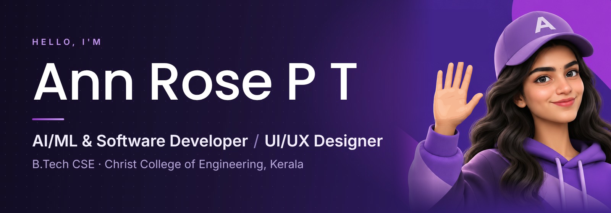
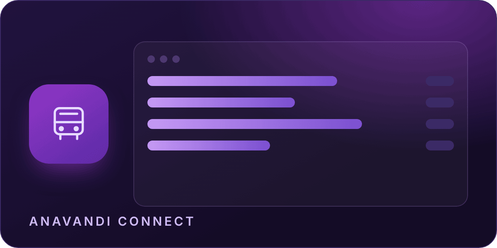
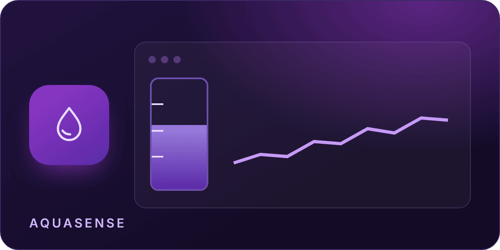

  &nbsp;
  &nbsp;
  &nbsp;
  

 

## About

- B.Tech Computer Science and Engineering at Christ College of Engineering, Irinjalakuda (2024–2028).
- Building AI/ML and software solutions, from GenAI assistants to machine-learning web apps.
- Developing full-stack applications with React, Spring Boot, Django and FastAPI.
- Designing UI/UX and visual communication; Design Team Lead at IEEE EMBS, CCE.
- Exploring cybersecurity and innovation through hands-on labs, hackathons and a published patent.

 

 

## Tech Stack

<table>
  <tr>
    <td width="140"><b>Programming</b></td>
    <td></td>
  </tr>
  <tr>
    <td><b>Frontend</b></td>
    <td></td>
  </tr>
  <tr>
    <td><b>Backend</b></td>
    <td></td>
  </tr>
  <tr>
    <td><b>AI / ML</b></td>
    <td>&nbsp; <code>NumPy</code> <code>Pandas</code></td>
  </tr>
  <tr>
    <td><b>Tools</b></td>
    <td></td>
  </tr>
</table>

 

## Featured Projects

<table>
  <tr>
    <td width="50%" valign="top">
      
      <h3>Anavandi Connect</h3>
      
AI-powered digitization of public transport timetables.

      
<code>Next.js</code> <code>TypeScript</code> <code>Tailwind CSS</code>

      <a href="https://github.com/AnnRosePT/anavandi-connect">Repository</a> · <a href="https://anavandi-connect.vercel.app">Live demo</a>
    </td>
    <td width="50%" valign="top">
      
      <h3>AquaSense</h3>
      
STM32 water-level monitor streaming live data to a web dashboard with alerts.

      
<code>Embedded C</code> <code>STM32 HAL</code> <code>React</code> <code>Python</code>

      <a href="https://github.com/AnnRosePT/Aquasense">Repository</a>
    </td>
  </tr>
  <tr>
    <td width="50%" valign="top">
      
      <h3>PlacementAI</h3>
      
Student placement prediction with an explainable scikit-learn model and analytics.

      
<code>React</code> <code>Flask</code> <code>Scikit-learn</code> <code>Pandas</code>

      <a href="https://github.com/AnnRosePT/placed">Repository</a>
    </td>
    <td width="50%" valign="top">
      
      <h3>DBT-GUARD</h3>
      
Flags Direct Benefit Transfer payments likely to fail before disbursement.

      
<code>React</code> <code>TypeScript</code> <code>Vite</code>

      <a href="https://github.com/AnnRosePT/DBT-GUARD">Repository</a> · <a href="https://dbt-guard.vercel.app">Live demo</a>
    </td>
  </tr>
</table>

 

## Patents, Certifications & Achievements

<table>
  <tr>
    <td width="140"><b>Patent</b></td>
    <td><i>Guardian Wing: Collaborative Fleet Intelligence System</i> Indian patent application No. 202641048328 · Status: Published · Co-inventor</td>
  </tr>
  <tr>
    <td><b>Hackathons</b></td>
    <td>Top 10 of 300+ teams, She Builds Tech 3.0, Kerala Startup Mission (2026) Top 32 of 400+ teams, ANAVANDI Hackathon 2026</td>
  </tr>
  <tr>
    <td><b>Innovation</b></td>
    <td>DBT-GUARD selected for the Kerala Startup Mission Pre-Incubation Programme</td>
  </tr>
  <tr>
    <td><b>Certifications</b></td>
    <td>Google UX Design · Meta Front-End Development · NPTEL Python for Data Science (IIT Madras) · AWS Cloud Essentials · Java Spring Boot · Figma Mastery</td>
  </tr>
</table>

 

## GitHub Stats

  
  

  

 

Building technology. Exploring possibilities. Creating impact.

