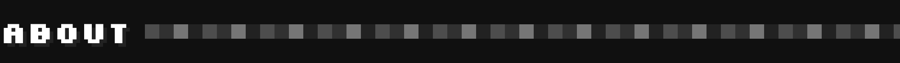
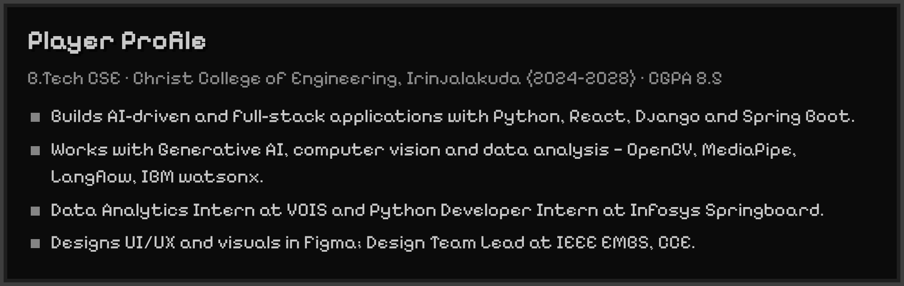
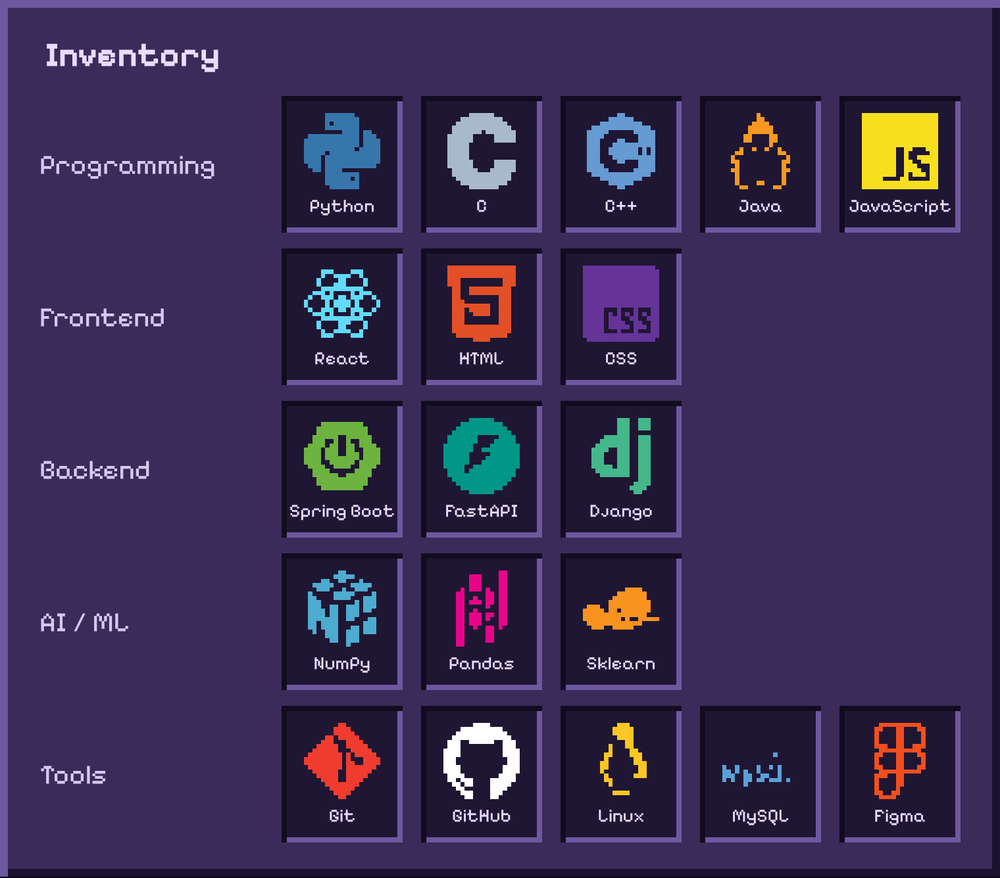
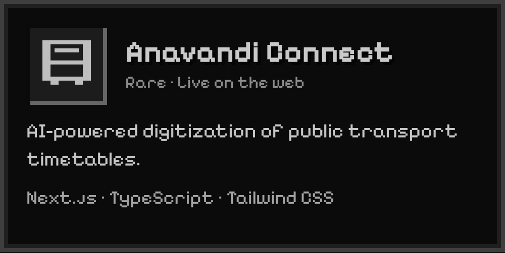
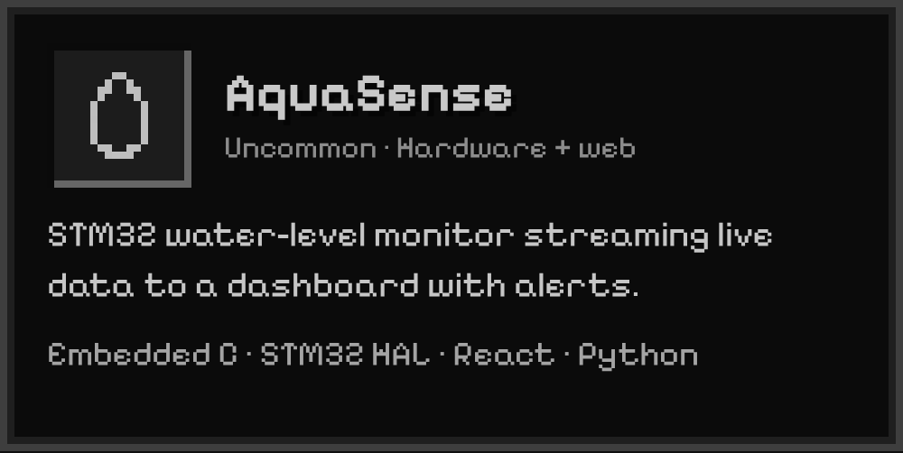
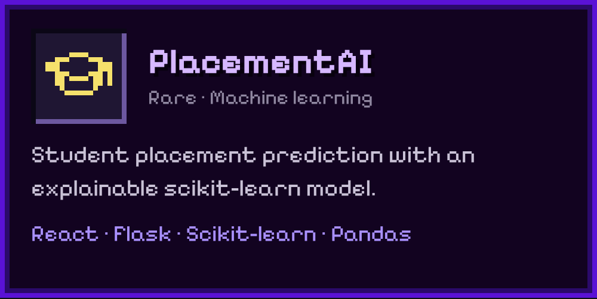
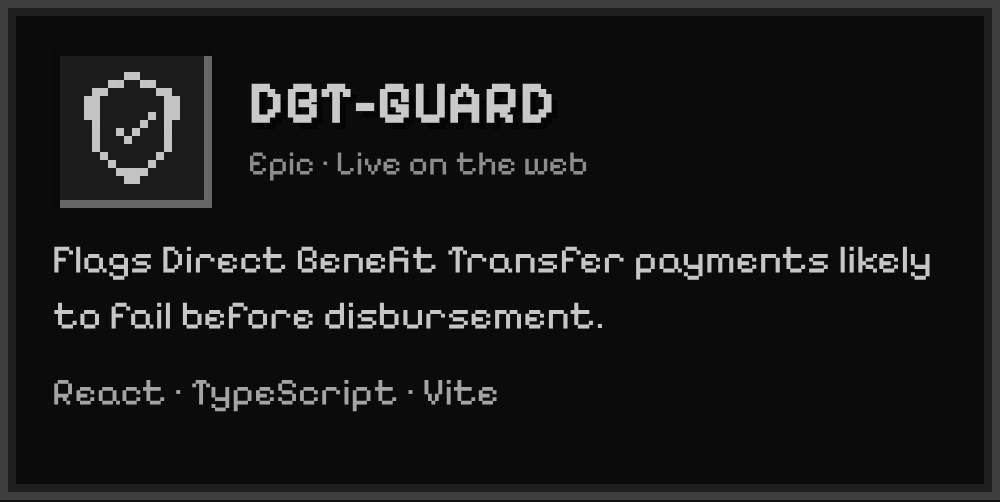
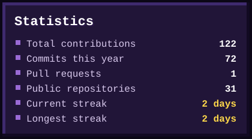
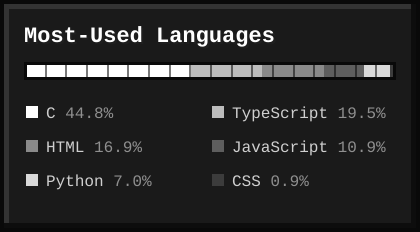

  
  
  
  
  

  

<table>
  <tr>
    <td width="50%" valign="top" align="center">
       
      <a href="https://github.com/AnnRosePT/anavandi-connect">Repository</a> · <a href="https://anavandi-connect.vercel.app">Live demo</a>
    </td>
    <td width="50%" valign="top" align="center">
       
      <a href="https://github.com/AnnRosePT/Aquasense">Repository</a>
    </td>
  </tr>
  <tr>
    <td width="50%" valign="top" align="center">
       
      <a href="https://github.com/AnnRosePT/placed">Repository</a>
    </td>
    <td width="50%" valign="top" align="center">
       
      <a href="https://github.com/AnnRosePT/DBT-GUARD">Repository</a> · <a href="https://dbt-guard.vercel.app">Live demo</a>
    </td>
  </tr>
</table>

  
  

Building technology. Exploring possibilities. Creating impact.

